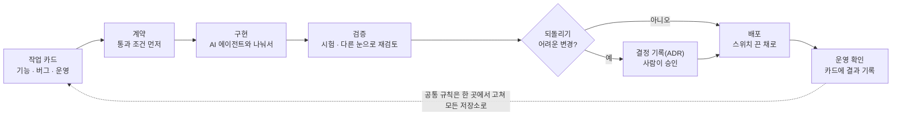

<picture>
  <source media="(prefers-color-scheme: dark)" srcset="https://raw.githubusercontent.com/choco5958/choco5958/main/assets/hero-dark.svg">
  
</picture>

  <a href="mailto:choco5958@naver.com"><b>choco5958@naver.com</b></a> ·
  <a href="#지금-하는-일">지금 하는 일</a> ·
  <a href="#일하는-방식">일하는 방식</a> ·
  <a href="#경력">경력</a> ·
  <a href="#개인-제품">개인 제품</a> ·
  <a href="#기술-스택">기술 스택</a>

> **Full-stack developer, 5+ years.** I build multi-tenant SaaS for physical stores — one shared core, many industry services, from first commit to app-store release and day-to-day operation.

## 30초 요약

- **지금** — 아이엔지스토리에서 스터디카페·헬스장 같은 매장용 SaaS의 **공통 코어**를 만들고, 그 위에 **업종별 서비스 6종**을 찍어내 운영합니다.
- **방식** — 일은 작업 카드로 시작해 운영 확인 기록으로 끝냅니다. 구현은 AI 에이전트와 나눠 하고, 무엇이 통과해야 끝인지와 배포 여부는 제가 정합니다.
- **이전** — 휴넷(프리랜서)·인라이플·파이어볼트·디휴브에서 React·Vue·PHP 서비스를 개발했습니다. 응답 속도를 **1.1s → 0.38s**로, Lighthouse 점수를 **68 → 92**로 올렸습니다.

<picture>
  <source media="(prefers-color-scheme: dark)" srcset="https://raw.githubusercontent.com/choco5958/choco5958/main/assets/stats-dark.svg">
  
</picture>

## 지금 하는 일

**아이엔지스토리** · 풀스택 개발 · 2026.08 ~ 지금

유·무인 매장(스터디카페, 무인 창고, 헬스장, 연습실 …)을 운영하는 회사입니다. 업종마다 서비스를 따로 만들지 않고, **회원·이용권·예약·결제·출입·키오스크를 담은 코어 하나**를 업종 서비스들이 버전을 고정해 가져다 쓰는 구조를 만들고 있습니다. 사내 저장소 <!--n:repos-->8<!--/n-->곳에서 <!--n:period-->2026.08.06 ~ 10.23<!--/n--> 동안 커밋 <!--n:commits-->3,470<!--/n-->건을 남겼습니다.[^count]

<picture>
  <source media="(prefers-color-scheme: dark)" srcset="https://raw.githubusercontent.com/choco5958/choco5958/main/assets/daily-dark.svg">
  
</picture>

### 01 · 공통 코어 · 디자인 시스템 <code><!--n:area_core-->958<!--/n--> commits · <!--n:pct_core-->28%<!--/n--></code>

- 업종 서비스가 함께 쓰는 앱 코어 **7개 패키지**: 서버, DB, API 클라이언트, 본사 콘솔, 지점 어드민, 고객 웹, 키오스크 웹
- 코어를 **4주 동안 0.1.0 → 0.1.115**까지 배포했습니다. DB 이관 **147개**에는 테넌트별 행 격리(RLS), 직원 권한·감사 기록, 가상계좌·환불, 수영 강습 반 편성 등이 들어 있습니다.
- 개인정보(인증번호·발송 기록)를 **암호화하고 기존 행을 채운 뒤 대조**했습니다. 암호화 백업은 키를 바꿔 가며 복구 리허설까지 했습니다.
- **디자인 시스템 6.0**, 키오스크 공용 킷 1.6, 문자·알림톡 SDK를 사내 패키지 저장소로 배포합니다. 화면이 달라지면 배포를 막는 시각 회귀 검사도 두었습니다.

### 02 · 업종별 서비스 6종 <code><!--n:area_saas-->1,652<!--/n--> commits · <!--n:pct_saas-->48%<!--/n--></code>

- 무인 창고 · 웰니스 · 보드게임 카페 · 복합문화공간 · 음악 연습실 · 헬스장
- 서비스마다 <b>고객 웹 · 지점 어드민 · 본사 콘솔 · 키오스크(안드로이드 · 토스 단말)</b>를 한 묶음으로 만들고, 도메인 전환까지 마쳤습니다.
- 고객 앱을 **App Store · Google Play**에 냈습니다. 심사 반려(4.2) 사유를 고쳐 다시 제출했고, 토스 키오스크 앱 심사 반려도 고쳐 통과시켰습니다.
- 매장 요청을 기능으로 옮겼습니다. 만석일 때 대기 등록 후 자리가 나면 문자 알림, 카드 결제를 환불하면 이용권과 출입 권한 회수, 1/N 분할 정산 등입니다.

### 03 · 인프라 · 배포 표준 <code><!--n:area_infra-->694<!--/n--> commits · <!--n:pct_infra-->20%<!--/n--></code>

- Terraform 공용 모듈 **20개**와 새 서비스 찍어내기 스크립트를 만들었습니다. 명령 한 줄로 인증서, 소개 사이트, 파이프라인, 서버(VPC · ECS · ALB · WAF)가 생깁니다.
- 배포 시간을 **16.0분 → 9.4분**, **14.1분 → 8분대**로 줄였습니다. 모두 같은 파이프라인에서 잰 전후 값입니다.
- 매일 백업 하나를 **새 DB에 풀어 표마다 행 수를 운영 DB와 대조**합니다. 행 격리 설정이 빠지면 실패로 처리합니다.
- 서버를 **ARM64**로 옮기고 NAT 게이트웨이를 NAT 인스턴스로 바꿔 비용을 줄였습니다. 저장소와 CI는 GitLab에서 AWS CodeCommit · CodeBuild · CodeArtifact로 옮겼습니다.

### 04 · 상담 플랫폼 기여 <code><!--n:area_cx-->166<!--/n--> commits · <!--n:pct_cx-->5%<!--/n--></code>

- 기존 외부 상담 도구를 대신할 자체 상담 플랫폼에 참여했습니다. 상담원 데스크를 고치고, 저장해 둔 답변(상용구)을 옮겨 오는 기능을 만들었습니다.
- 네이버 채널 연동을 **기능 스위치를 끈 채** 단계별로 들였습니다(큐 · 암호 키 · 발송 서비스).
- 고객 위젯에 안 읽음 배지를 달고, 전환 직전에 답하지 않은 대화를 찾는 점검 쿼리를 만들었습니다.

<a href="#top">↑ 위로</a>

## 일하는 방식

- **카드로 시작해 운영 확인으로 끝냅니다.** 기능 <!--n:feat-->273<!--/n--> · 버그 <!--n:bug-->90<!--/n--> · 운영 <!--n:ops-->180<!--/n--> 카드, 결정 기록 <!--n:adr-->191<!--/n-->건을 남겼습니다.
- **"코드 완료"와 "매장에서 동작"을 구분해 적습니다.** 실제 업체 연동이나 실매장 적용이 남았으면 완료로 쓰지 않습니다.
- **새 기능은 스위치를 끈 채 배포합니다.** 운영 반영은 한 번에 하나씩 하고, 배포 결과를 카드에 남깁니다.
- **버전이 어긋나면 배포가 멈춥니다.** 운영 DB보다 새 스키마를 기대하는 코드는 배포를 막고, 패키지 버전이 어긋나면 출시 검사에서 거절합니다.
- **AI 작업 규칙은 한 저장소에서 관리합니다.** 바꾼 규칙은 스크립트로 모든 프로젝트에 반영하고, 하루 일은 세션 기록과 git 이력을 대조한 퇴근보고로 닫습니다.

<a href="#top">↑ 위로</a>

## 경력

<picture>
  <source media="(prefers-color-scheme: dark)" srcset="https://raw.githubusercontent.com/choco5958/choco5958/main/assets/timeline-dark.svg">
  
</picture>

| 기간 | 회사 | 한 일 |
| :-- | :-- | :-- |
| 2026.08 ~ 지금 | **아이엔지스토리** | 매장용 SaaS 공통 코어 · 업종별 서비스 6종 · 인프라 표준 |
| 2026.04 ~ 2026.07 | **휴넷** · 프리랜서 | EDMS 필수교육 관리자 기능 신규 개발(프론트엔드) |
| 2024.10 ~ 2026.04 | **인라이플** · 주임 | 신규·기존 서비스 프론트엔드 설계, 백오피스 풀스택, 운영 안정화 |
| 2022.01 ~ 2024.06 | **파이어볼트** · 사원 | PHP 템플릿을 React SPA + API 구조로 전환, 성능 최적화 |
| 2021.06 ~ 2021.11 | **디휴브** · 사원 | 기능 단위 풀스택 개발, UI/UX 개선 |

<table>
<tr>
<td width="50%" valign="top">

**휴넷** · 프리랜서 · EDMS 필수교육 관리자
- 대시보드 · 교육 목록 · 개인별 이수 현황 · 등록/수정 · 사용 설정까지 관리자 화면을 **새로 설계하고 구현**
- 교육 상태별 현황, 배정 인원, 평균 이수율, 기한 임박 정보를 대시보드로
- nuqs로 검색 조건과 페이지를 **URL과 맞춰** 새로고침 · 링크 공유에도 같은 화면 유지
- 대상자 · 과정을 단건 검색, 조직 선택, **엑셀 일괄 업로드**로 등록하고, 중복 · 미존재 · 형식 오류를 미리 걸러 오류 내역을 내려받게 함

React · TypeScript · React Query · nuqs · xlsx

</td>
<td width="50%" valign="top">

**[iSend](https://isend.co.kr)** · 인라이플
- CRM 기반 타겟 메시지 UI와 조건 로직 고도화
- 대량 조건을 그릴 때 생기는 렌더링 병목을 찾아 컴포넌트 구조 개선
- 퍼널 · 리텐션 데이터로 발송 대상 세분화

</td>
</tr>
<tr>
<td width="50%" valign="top">

**DBAY** · 인라이플 · 서비스 종료
- React · Next.js · TypeScript 초기 구조 설계
- 유입을 고려한 렌더링 방식 선택, ESLint · Prettier 규칙 정립

**[Shortpang](https://mobile.shortpang.com)** · 인라이플
- 합류 직후 구조 파악, 렌더링 병목과 런타임 오류 감소

</td>
<td width="50%" valign="top">

**[Shoplus](https://play.google.com/store/apps/details?id=com.enliple.shopplusapp)** · 인라이플
- PHP · MySQL 프론트와 백오피스, 결제 · 적립 예외 정리
- Git 기반 배포 절차로 사람 실수 감소

</td>
</tr>
<tr>
<td width="50%" valign="top">

**[witchform.com](https://witchform.com)** · 파이어볼트
- PHP 템플릿을 **React SPA + REST API**로 다시 설계
- Redis 캐시로 API 응답 **1.1s → 0.38s**
- CSR SEO를 고쳐 Lighthouse **68 → 92**
- Zustand로 상태 흐름 단순화

</td>
<td width="50%" valign="top">

**[repickus.com](https://repickus.com)** · 디휴브
- 단일 입력 페이지를 단계별 입력 흐름으로 개선
- 상품 코드로 시세를 조회하고 감가율을 추정하는 로직 개발

</td>
</tr>
</table>

<a href="#top">↑ 위로</a>

## 개인 제품

혼자 기획부터 배포까지 합니다.

| 제품 | 한 줄 |
| :-- | :-- |
| **루픽 LOOPIC** 🛠️ 개발 중 | 인스타 · 스레드 · 유튜브 · 틱톡 · 네이버 채널별로 소재 → 제작 → 검토 · 게시 → 성과까지 잇는 SNS 수익화 자동화. Next.js 16 · Drizzle · PostgreSQL |
| **[DDakDeal](https://ddakdeal.com)** 🟢 운영 중 | 전문가 매칭 플랫폼. 결제 웹훅을 멱등하게 처리하고 트랜잭션으로 묶어 데이터 무결성 확보, 웹 · Android · iOS를 한 코드로. Next.js · Supabase · Capacitor |
| **[FastBizKit](https://fastbizkit.com)** 🟢 운영 중 | 도구 100개 이상(경로 240개 이상)의 업무 도구 모음. FFmpeg.wasm · pdf-lib로 파일을 브라우저에서 처리. Next.js · Cloudflare · Vercel |
| **[image-crop-app](https://github.com/choco5958/image-crop-app)** 🛠️ 개발 중 | 이미지 자르기 · 보정 모바일 앱. Expo · React Native |

## 기술 스택

<picture>
  <source media="(prefers-color-scheme: dark)" srcset="https://raw.githubusercontent.com/choco5958/choco5958/main/assets/stack-dark.svg">
  
</picture>

## GitHub 활동

<picture>
  <source media="(prefers-color-scheme: dark)" srcset="https://raw.githubusercontent.com/choco5958/choco5958/output/github-contribution-grid-snake-dark.svg">
  
</picture>

회사 코드는 사내 저장소에 있어 이 잔디에는 거의 잡히지 않습니다. 회사 작업량은 위의 일별 커밋 그림을 봐 주세요.

## 학력 · 활동

- **한국방송통신대학교 컴퓨터과학과** 편입 · 졸업 (2024.03 ~ 2026.02)
- **배재대학교 러시아학과** 졸업 (2014.03 ~ 2020.02)
- 코리아IT아카데미 Java 풀스택 과정 수료 (2020.12 ~ 2021.05)
- 카자흐스탄 교환학생 (2018.08 ~ 2019.05), 카자흐스탄 대통령 방한 프레스센터 운영 지원 (2019.04), 원주 다이내믹 댄싱카니발 러시아어 통역 봉사 (2019.09)

<picture>
  <source media="(prefers-color-scheme: dark)" srcset="https://raw.githubusercontent.com/choco5958/choco5958/main/assets/divider-dark.svg">
  
</picture>

<b>풀스택 · 프론트엔드 · 백엔드 포지션과 협업 제안을 기다립니다.</b> <a href="mailto:choco5958@naver.com">choco5958@naver.com</a>

[^count]: 회사 저장소 <!--n:repos-->8<!--/n-->곳에서 본인 이메일로 남긴 커밋만, 병합 커밋을 빼고 중복 없이 셌습니다(<!--n:generatedAt-->2026-10-23<!--/n--> 기준, 최다일 <!--n:peak-->10.08 · 255건<!--/n-->). 상당수는 AI 에이전트와 작업 단위로 나눠 남긴 커밋이라 직접 친 코드의 양과는 다릅니다. 영역은 저장소별로 나누되, 커밋 제목의 범위가 infra · ci · ops 등이면 인프라로 셌습니다. 저장소 이름과 사내 브랜드는 싣지 않았습니다.
